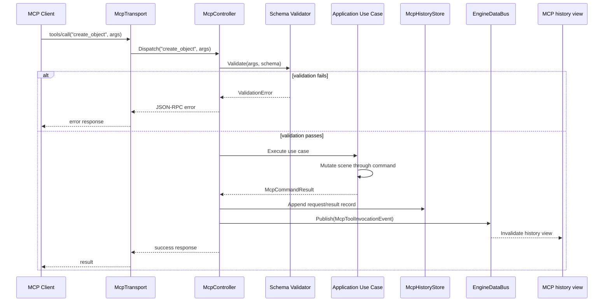

# MCP Architecture

## Purpose

This document defines the Model Context Protocol (MCP) integration in Horo
Engine. MCP exposes editor, scene, asset, build, and release operations to
external clients through a stable, typed protocol. The same application use
cases power GUI, CLI, and MCP interactions; MCP does not implement engine
business logic independently.

Normative decision: [ADR-177: MCP Application Capability and Host Boundary](../../adr/177-mcp-application-capability-and-host-boundary.md).

## Core Decisions

- MCP is a transport and in-process adapter over Horo application capabilities;
  it is never an authoritative domain API.
- Every entry path dispatches through one host-owned `McpController` and one
  immutable registry snapshot.
- Tool descriptors classify effects as `Query`, `PresentationSideEffect`, or
  `Mutation`; classification is explicit and mandatory.
- Protocol version, tool-contract version, and application-capability version
  are separate compatibility domains.
- Application errors, cancellation, deadlines, bounds, and operation ownership
  survive adapter translation without being converted into empty success.
- Domain targets never depend on MCP targets or types. Executable composition
  roots construct application owners before MCP adapters and tear them down after
  MCP admission closes and drains.

## Scope

MCP is available in both supported hosts:

- `HoroEditor`: the graphical host
- `horo-engine`: the terminal and headless host

MCP owns:

- transport and session lifecycle
- protocol schema and request/response serialization
- tool registry and dispatch
- request validation and error translation

MCP does **not** own:

- engine business rules
- direct mutation of scene, asset, renderer, or editor state from a transport
  thread
- ImGui or terminal presentation logic

## Ownership

```text
HoroEditor                    horo-engine
    |                             |
    +-- McpServer                 +-- McpServer
            |                             |
            +-- McpController             +-- McpController
                    |                             |
                    +-- Application Use Cases ----+
                            |
                    Scene, Asset, Build, Release, Diagnostics
```

`McpServer` owns the transport lifecycle. `McpController` owns protocol-level
validation and dispatch through a host-owned registry snapshot. Application
capabilities own the actual operations. Both transport and embedded in-process
adapters submit the same transport-neutral request context to that controller;
the embedded path has no privileged handler or service access.

## Transport Layer

The initial local profile is host-driven newline-delimited JSON-RPC 2.0 over a
host-owned byte stream (typically standard input/output or an approved local
pipe). `McpLocalTransport` owns framing and a session, but opens no socket,
pipe, thread, or listener. The executable composition in [CLI-001.7] owns
process streams and keeps logs off protocol output. The frame and decoded input
limits apply before and after parsing; partial oversized frames are discarded
through the next newline so subsequent messages remain synchronized.

`McpInProcessAdapter` passes decoded values without wire serialization. Both
adapters submit to one `McpSessionManager` and its injected, host-owned
`IMcpRequestController`, with identical admission, capability, project,
cancellation, deadline, and result budgets. Controller/registry implementation
belongs to later MCP tickets. Neither adapter grants its own capabilities or
selects a backend. No network transport is selected or authorized here.

## Session Lifecycle

1. Host composes one controller and session manager, then explicitly admits a
   local or embedded client with bounded identity, capabilities, revisions, and
   optional project identity.
2. A local host feeds byte chunks to the framing adapter; an embedded caller
   passes request values directly. Both use the same controller. Protocol
   `initialize`, tool listing, and tool execution remain controller-owned.
3. Disconnect closes the session and cancels its requests. A host-approved
   project switch advances its generation, cancels old work, and discards an
   incomplete local frame. Old handles cannot admit new work.
4. Shutdown closes admission, cancels sessions, and waits only its declared
   drain interval. A callback that outlives the interval retains its controller
   lease; shutdown reports a typed drain timeout rather than destroying it.

All engine mutations triggered by MCP are queued onto the main thread in the
GUI host. The CLI host runs them on the host's main thread directly.

## Tool Registry

Tools are registered in `McpController` by name. Every MCP tool is described by a
validated `McpToolDescriptor`. The descriptor is the protocol contract; the
handler is only the adapter that invokes the application use case.

```cpp
struct McpToolDescriptor {
    std::string name;
    std::string description;
    nlohmann::json inputSchema;
    nlohmann::json outputSchema;
    CapabilitySet capabilities;
    HostAvailability hosts;
    McpToolEffect effect;
    CancellationPolicy cancellation;
    TimeoutPolicy timeout;
    RateLimitPolicy rateLimit;
    McpToolVisibility visibility;
};
```

```cpp
// mcp/tools/CreateObjectTool.h
struct CreateObjectTool {
    static constexpr std::string_view Name = "create_object";

    static McpToolDescriptor Descriptor() {
        return {
            .name = std::string(Name),
            .description = "Create a scene object of a declared type",
            .inputSchema = R"({
                "type": "object",
                "properties": {
                    "name": { "type": "string" },
                    "primitiveId": {
                        "type": "string",
                        "description": "primitive catalog identifier"
                    }
                },
                "required": ["name", "primitiveId"]
            })"_json,
            .outputSchema = R"({
                "type": "object",
                "properties": {
                    "objectId": { "type": "string" }
                },
                "required": ["objectId"]
            })"_json,
            .capabilities = CapabilitySet{Capability::SceneMutation},
            .hosts = HostAvailability::Both,
            .effect = McpToolEffect::Mutation,
            .cancellation = CancellationPolicy::Cooperative,
            .timeout = TimeoutPolicy::FromDescriptor,
            .rateLimit = RateLimitPolicy::Default,
            .visibility = McpToolVisibility::Public
        };
    }

    static McpCommandResult Execute(IObjectCreationCapability& capability,
                                    const ObjectCreationRequest& request,
                                    const McpRequestContext& context);
};
```

The set of supported `primitiveId` values is generated from the
`PrimitiveCatalog` defined in
[Built-In Scene Primitives](../runtime/built-in-scene-primitives.md). Hardcoded
object type lists in tool schemas are not permitted.

Registration:

```cpp
mcpController.RegisterTool<CreateObjectTool>();
mcpController.RegisterTool<ImportAssetTool>();
mcpController.RegisterTool<BuildProjectTool>();
```

### Registry delivery and migration boundary

`HoroMcpRegistry` now owns inert `McpToolDescriptor` values, a complete-candidate
`Publish`, and immutable, generation-numbered `McpToolSnapshot` readers. Host
composition supplies application adapters explicitly; registration does not run
them. The current tool identity is a stable lowercase token and the independent
tool version is `{major, minor, patch}`. Replacing a published identity cannot
change its major version or effect, or regress its version. A breaking contract
therefore needs a new stable tool identity until a later version-migration policy
is approved. Changes to effect, required capabilities, or schemas are likewise
rejected for a published identity. A host supplies its available-capability
inventory at publication; an unavailable descriptor rejects the whole candidate.
Required capabilities are set-valued: publication rejects duplicate identities
and stores them in canonical sorted order, so reordering the same grants does not
make a replacement incompatible.
`McpToolRegistration` also declares an `McpOwnerContext`; this host-owned value routes the adapter to
Editor, Runtime, Background, or Build execution. Publication rejects an omitted
owner instead of silently routing work to a frame-sensitive context. This is a
deliberate registration migration: the registry test authoring helper and every
host composition that publishes MCP tools must set the owner explicitly. The
registry retains the snapshot and adapter lease for each active operation
across publication changes until its owner invocation starts.

The registry admits a deliberately closed, non-referencing JSON Schema subset:
`type`, `properties`, `required`, boolean `additionalProperties`, `items`, `enum`,
`minItems`, `maxItems`, `minLength`, `maxLength`, `minimum`, and `maximum`.
Unsupported keywords fail registration rather than being ignored. Enum members
must match their declared type and supported bounds; duplicates are rejected.
String length bounds in this initial contract count UTF-8 bytes; descriptors
needing Unicode scalar or grapheme length, references, unions, or conditional
schemas require an explicit validator revision before admission. Per-tool byte,
depth, and node limits apply before adapter invocation and to adapter output.
Discovery is sorted and filtered by host-approved capability identities.
Authentication, trust, approval, owner-thread scheduling, and protocol framing
remain with their separate owners; registry capability filtering is not a
substitute for them.

The host validates tool names, schemas, capabilities, effect category,
supported hosts, and permission requirements before advertising the tool to a
client.

The registry implementation and public descriptor types are delivered by
[MCP-001.3]. Their contract is fixed here: every descriptor declares exactly one
closed effect category.

| Effect | Allowed behavior |
|---|---|
| `Query` | Read one authoritative bounded snapshot. It cannot change focus, selection, documents, caches, external systems, or domain state. |
| `PresentationSideEffect` | Request an ephemeral interactive-host action such as reveal, focus, or selection through an application controller. It cannot mutate portable project state. |
| `Mutation` | Change durable state, start externally observable work, or perform an external side effect through an authoritative application capability. |

Discovery exposes this category to clients and authorization policy. Missing or
unknown categories reject registration. Runtime behavior that exceeds the
declared category is a contract violation; a query reports a repair proposal
rather than repairing state implicitly.

## Request Lifecycle



## Tool Result Envelope

Tool results use a stable envelope unless the tool descriptor declares a custom
schema.

```json
{
  "schemaVersion": 1,
  "requestId": "mcp-42",
  "tool": "build_project",
  "status": "succeeded",
  "result": {},
  "diagnostics": [],
  "operationId": null
}
```

- `schemaVersion`, `requestId`, `tool`, and `status` are always present.
- `result` follows the tool's declared output schema.
- `diagnostics` contain safe, structured diagnostics.
- `operationId` is set when the tool created a long-running operation.

Failures use JSON-RPC error envelopes. The `error.data` field contains the
canonical Horo error payload. Protocol-level errors use the JSON-RPC error code;
engine-level errors use `-32000` with the structured error payload.

## Long-Running Tool Lifecycle

MCP tools that start long-running operations return an operation-aware result.
A tool may either:

1. complete synchronously within the request budget, or
2. create an application operation and return an `operationId`.

Long-running tools expose:

- request ID
- operation ID
- cancellation token
- timeout policy
- progress subscription or polling tool
- final result query

Example response for a long-running tool:

```json
{
  "schemaVersion": 1,
  "requestId": "mcp-42",
  "tool": "build_project",
  "status": "running",
  "result": null,
  "diagnostics": [],
  "operationId": "op-123"
}
```

Transport threads must not block indefinitely waiting for long-running engine
work. The application use case creates jobs and operation records; MCP reports
operation progress through declared protocol messages or explicit query tools.

[ADR-106](../../adr/106-navigation-bake-ownership-transaction-and-cache.md)
requires the navigation-bake tool to validate project-write/cook capability and
project-contained typed IDs, then submit the same application
`NavigationBakeService` request as GUI, CLI and release cook. It returns the
accepted or joined `operationId` and observes the shared operation result. The MCP
controller owns only protocol/request lifetime; disconnect follows the declared
detach/cancel policy and cannot destroy a detached bake, release its publication
lock, mutate cache/staging or call `INavigationMeshBuilder` directly.

## Request Cancellation

Every accepted MCP request owns or joins a cancellation token. If the client
sends a cancellation notification, disconnects, or the request timeout expires,
the controller requests cooperative cancellation on the associated application
operation or task group.

Cancellation maps to the canonical Horo `job.cancelled` or timeout/platform
error codes and is returned through the JSON-RPC error/data payload or the
operation status query.

Cancellation rules:

- a cancelled synchronous tool returns a JSON-RPC error with `job.cancelled`;
- a cancelled long-running tool updates its operation state and exposes the
  cancellation through the operation status tool;
- forced termination after cancellation maps to `platform.process.terminated`;
- client disconnect detaches or cancels according to the tool's detach policy.

## Threading

MCP transport threads must not mutate engine or editor state directly.

In `HoroEditor`:

- transport receives requests on its own thread
- requests are queued to the GUI/editor main thread
- use cases execute on the main thread
- the initial response carries an operation ID without waiting for owner work

In `horo-engine`:

- transport receives requests on its own thread
- the CLI host has a single main thread that processes the queue
- editor/runtime use cases execute on the main thread; background/build work is
  pumped on host-owned workers

The host binds each context to its owning thread and calls `McpController::Pump`
from that scheduler. A `tools/call` request admits a bounded queued operation and
returns its ID immediately. `operations/get` and `operations/cancel` use the same
session manager for local and embedded callers. Each operation retains its
request ID, session generation, deadline, cancellation chain, registry snapshot,
and application adapter lease. Queued cancellation removes work before execution;
running cancellation requests cooperation and makes one terminal result. The
owner callback may continue until its application capability observes the token;
shutdown waits a finite drain interval and reports a typed timeout if that
capability does not cooperate. Editor/runtime adapters start slow application
work through `InvokeAsync`, retain its completion callback, and return promptly
from the owner pump. Progress and the exactly-once terminal callback may arrive
from an application worker. Short synchronous adapters use the default
`InvokeAsync` bridge; slow synchronous work belongs on the host's Background or
Build scheduler. No controller-owned thread or process is created. An async
adapter retains its application-owner lease and invokes completion even after
cancellation; on a drain timeout, host composition must keep that owner alive
until its jobs/processes have stopped and callbacks have completed. Controller
destruction cannot forcibly terminate an application-owned job or process.

An owner may lease a sensitive result to the controller for a single
`operations/get` delivery. The lease binds a monotonic deadline and weak source
lifetime without calling the owner from the transport thread. A lease applies
only to that running operation. Revoked, expired, and already received
payloads return operation-unavailable.

## Error Handling

MCP errors are translated into JSON-RPC error objects:

| Error            | Code   | Meaning                            |
| ---------------- | ------ | ---------------------------------- |
| Parse error      | -32700 | Invalid JSON                       |
| Invalid request  | -32600 | Malformed JSON-RPC                 |
| Method not found | -32601 | Unknown tool                       |
| Invalid params   | -32602 | Schema validation failed           |
| Internal error   | -32603 | Unexpected engine failure          |
| Engine error     | -32000 | Use case returned structured error |

Application use cases return typed `Result<T, Error>` values. `McpController`
translates engine errors into JSON-RPC payloads without leaking internal
implementation details.

The registry-backed reference `Horo::Hosts::TranslateMcpError` wraps the same
canonical application error used by GUI, CLI and Python in `error.data` with
protocol code `-32000`. A composition root supplies exact exposed mappings and
the active registry; unregistered errors are contract failures. The transport
retains responsibility for request identity and protocol failures. Disclosure,
bounds and migration from the earlier lifecycle-only `SafeErrorData` projection
are specified by
[Host Translation](../foundation/error-and-diagnostics.md#host-translation).

## Adding A New MCP Tool

1. Define the tool struct in `mcp/tools/<Name>Tool.h`.
2. Implement `Execute` in `<Name>Tool.cpp` using application use cases only.
3. Register the tool in `McpController::RegisterDefaultTools()`.
4. Add a contract test in `tests/contract/mcp/`.
5. Add a protocol test in `tests/mcp/`.
6. Update MCP tool documentation if the tool is user-facing.

## Capabilities

The server advertises the following capabilities:

- `tools`: list and call tools
- `logging`: stream authorized, filtered, and redacted structured log messages
- `prompts`: optional prompt templates for common workflows

Resources are not exposed through MCP; scene and asset data are accessed
through tools, not resource URIs.

## Bounded Query Results

Tools that return scene, asset, diagnostics, log, or operation data must use
bounded result sets.

Query tools support:

- `limit`
- `cursor` or `pageToken`
- revision number where applicable
- stable ordering
- partial result metadata

Tools must not return unbounded scene graphs, logs, profiler data, or asset
lists in one response. Streaming JSONL tools declare a per-record schema and
bounded chunk size.

The embedded editor's scene inspection grant exposes `inspect.transforms`
as an owner-lane query. It returns authored local translations, quaternions
and scales, local and committed world matrices in row-major order, and the
world-space pivot for explicitly supplied visible object IDs. The
request is bounded to 16 IDs and continuations repeat the exact Scene epoch
and revision from the previous result. Play copies, retired workspaces and
missing or hidden objects fail closed.
The same grant exposes `inspect.bounds`, which applies committed authored
world transforms to matching published mesh bounds. It reports the axis-aligned
minimum and maximum and both boxes' centers, half-extents, and volumes. The
oriented box includes three orthonormal world-space axes aligned to the object's
affine frame. The enclosure remains conservative under non-uniform scale,
reflection, and shear. Missing or stale geometry produces an explicit
unavailable result. Gizmo previews are excluded.
The same object and page contract applies to `inspect.components` and
`inspect.rendering`. Component inspection reports authored presence and counts
without component payloads. Rendering inspection reports per-object committed
instance, vertex and triangle counts from retained geometry, with an explicit
unavailable result when no matching geometry is published.
`inspect.distances` measures each requested target against an explicit
visible reference object. It returns the world AABB gap, per-axis overlap
depths, a deterministic nearest-point pair and the angle between the two
committed transformed local forward axes.
`inspect.grid_offsets` uses the same committed world pivot and an explicit
positive step on a zero-origin world grid. It reports the nearest aligned
position and the signed correction on each axis without editing the Scene.
Midpoints round away from zero.
`inspect.surfaces` takes a world-space ray origin, direction, and positive
maximum distance. It returns the closest triangle hit per requested object
from the committed viewport mesh. A hit carries its distance, world position,
geometric normal in triangle winding order, and slope relative to world up.
A valid miss omits the sample. Missing mesh data and requests exceeding the
65,536-triangle page budget produce explicit errors.
`inspect.collisions` pages through the authored colliders contributed by one
visible object. Each row identifies the visible body and collider slots and
reports the body-local pose, scale, flags, and analytic shape dimensions.
Asset-backed shapes expose their kind. A reference to an unavailable body
fails explicitly. Continuations use the same Scene fence as the other tools.
`inspect.penetrations` takes an ordered pair of visible body owners and an
explicit project Physics query-channel UUID. It reads the source body's
published shape and pose, excludes self-hits, and reports the deepest
positive overlap against the second body. Contact position is measured in
the current Physics origin frame. The sample is absent for an admitted pair
with no positive contact. Disabled or unavailable Physics and capacity
failures propagate as explicit errors.
`inspect.visual_issues` samples up to 16 specified objects with one editor
camera observation. The request supplies a viewport aspect ratio and a
top-left-origin normalized rectangle. Each row describes the intersection
of the projected world bounds with that region and whether clipping occurred.
It also reports the largest projected overlap with another requested object
using normalized viewport area. These diagnostics describe bounding geometry.

## MCP History Retention And Redaction

`McpHistoryStore` stores bounded request summaries, not arbitrary full payloads.

The store records:

- host-generated request and operation correlation
- tool name
- timing
- status
- safe diagnostics summary

Tool arguments and results are redacted according to the tool descriptor.
Secrets, credentials, raw file contents, and large payloads are never retained
in history by default. History retention is policy-bounded by count, age, and
storage budget.

Session, approval, and dispatch owners publish schema-versioned `mcp.audit`
records to the process's bounded asynchronous JSONL log. Numeric principal,
session, approval, and operation identities correlate related records without
retaining caller-supplied request IDs or names. Operation records identify
registered tools and include status and elapsed time. Arguments, application
results and messages, credentials, and ambient context stay outside the audit
projection. A full or disabled log queue never gates command execution.

The editor's bottom-dock MCP tab displays the most recent 256 matching typed
records retained by the live process log. Its search, approval and error filters
apply to both the displayed rows and the explicit CSV copy action. The export
uses only the validated audit schema and host-generated correlations.
Active controls query the authenticated owner directly and remain available while
history is paused or unavailable. An operator can read the current grants,
cancel a queued or executing MCP request, or revoke the entire session and its
native workspace leases. Actions reject a retired session generation.

## Save Tool Boundary

MCP save tools follow
[ADR-116](../../adr/116-save-data-threat-model-and-trust-policy.md). Inspect, import,
export, migrate, load, delete and conflict resolution declare separate capabilities,
side-effect policy, confirmation policy and shipping-profile availability. Project
trust or an authenticated MCP session does not imply access to another product,
environment, user, profile, server-world or slot namespace.

Tool handlers pass typed addresses or explicitly admitted external-file handles to
application-owned save use cases. They do not call archive codecs, read arbitrary
paths, select trust roots, access provider/signing credentials, retain leases or
publish runtime/catalog state from an MCP thread. Every source, including a local save
path or authenticated cloud result, follows bounded untrusted-input admission.

Inspection results contain bounded allowlisted metadata, verification state and safe
diagnostics. Raw archive/participant content, unrestricted paths, credentials and
private provider identity are excluded from request history and ordinary results.
Development-only raw export requires a distinct local capability and cannot be
enabled by a remote caller or archive field.

## Security

[MCP authentication and approval migration](../../guides/mcp-authentication-approval-migration.md)
defines the implemented local credential and approval boundary. Host composition
injects one `McpAuthorization` into sessions and the controller. Protected discovery
and invocation require a live, non-forgeable principal bound to exact project trust,
capabilities and registry revisions. Non-query tools require a local, expiring,
single-use approval bound to the exact request; the registry consumes it at owner
invocation. Project replacement and revocation cancel old authority rather than
carrying approval into another project. No mutable policy or credential material
is exposed through protocol frames. The new header is owned by `HoroMcpSession`,
whose one-way Security dependency supplies zeroizing secret and OS entropy contracts.

[ADR-172](../../adr/172-immersive-agent-ownership-authoring-mode-and-risk.md)
specializes immersive editor-agent tools. Multimodal input is bounded evidence,
not MCP authorization: voice, gaze, pointing, contact and physical interaction
cannot approve a tool plan. Mutating plans require a local proposal-bound approval
and still pass through application validation and an atomic editor transaction.
Mode, document, project or XR-session replacement invalidates approval; remote MCP
identity cannot impersonate locally present physical approval.

[ADR-122](../../adr/122-cinematic-trigger-sources-and-capability-policy.md)
specializes cinematic start/control tools. A registered tool remains an MCP adapter
over the common application `ICinematicPlaybackCapability`; it never receives the
runtime service. Mutating start requires authenticated/scoped caller identity where
applicable, trusted project, exact capability, target-world authority and the existing
operation approval. Authentication, localhost access or project trust alone is not
authorization, and approval is bound to the visible request/revision rather than
stored in sequence/project content.

Cinematic MCP start tools are Editor/local-development tooling by default and are
absent from Retail Shipping builds. Remote policy below still applies; a non-loopback
transport cannot widen the tool set. Denial uses the application typed result, creates
no player/effects and is redacted/audited without disclosing unavailable sequence or
world details.

- MCP transport does not accept anonymous remote connections in production.
- Any network transport requires authentication when exposed beyond localhost.
- Tool arguments are validated against JSON Schema before execution.
- Long-running tools support cooperative cancellation.
- Secrets are never returned in tool results or logs.

## Remote Transport Policy

Any future network transport binds to loopback by default. Binding to non-loopback
interfaces requires explicit configuration, authentication, and project trust
approval. The concrete remote transport and session policy are deferred to the
transport and security tickets.

Remote transports enforce:

- authentication
- optional origin allowlist
- request body size limits
- per-client concurrency limits
- per-tool rate limits
- idle timeout
- redacted audit logging

See [Release Security](../release/release-security.md) for signing and transport trust.

## Testing

MCP tests are organized into three layers:

1. **Protocol tests**: validate JSON-RPC framing and error codes.
2. **Tool tests**: validate individual tool behavior in isolation.
3. **Contract tests**: validate that GUI, CLI, and MCP produce the same results
   for the same operation.

Required additional coverage:

- client disconnect cancels or detaches according to tool policy
- cancellation of long-running build/import/release tools
- timeout maps to stable Horo error payload
- remote transport authentication and origin policy
- rate-limit and body-size enforcement
- bounded query pagination and stable ordering
- history redaction of secrets and large payloads
- save inspect/import/export/migrate/load/delete/conflict capability separation,
  hostile-input budgets, shipping remote denial and no raw save/path/credential history

Run MCP tests:

```bash
python3 scripts/dev.py test -- test_mcp
python3 scripts/dev.py test -- contract
```

## Debugging

Enable focused MCP protocol logging through the shared observability runtime:

```bash
HORO_LOG_LEVEL=info \
HORO_LOG_LEVELS=mcp.protocol=trace \
build/debug/bin/horo-engine mcp serve
```

The canonical user-facing command is `horo-engine mcp serve`; legacy aliases may
exist only as compatibility shims and must resolve to the same typed command
request.

`HORO_MCP_LOG=1` may remain as a compatibility alias for
`mcp.protocol=trace`. MCP records use the canonical structured schema, log
directory, rotation, context propagation, and redaction rules. Protocol logs
record frame boundaries, request IDs, tool names, timings, sizes, and result
status; they do not blindly persist complete request or response payloads.

## Adapter Equivalence

GUI, CLI, and MCP adapters must call the same application use cases for the same
business operation. Differences are limited to:

- input parsing and validation envelope
- presentation format
- transport/protocol error envelope
- interactive prompting policy
- progress delivery mechanism

They must not implement separate business rules, scene mutation paths, asset
import logic, build behavior, or release policy.

## Project code query pack

`HoroEngine::McpProjectCodeQuery` supplies seven inert Query registrations:
`project.files`, `project.text`, `project.search`, `project.symbols`,
`project.diagnostics`, `project.build_status`, and `project.test_status`.
They require the explicit `horo.project.code.query` grant and call the same
`Application::ProjectCodeQuery` capability available to other host adapters.
Clients supply portable relative names, never a native root or provider choice.

The host admits `Platform::IProjectReadFiles` separately. Its Foundation-only
contract retains native root identity and resolves every descendant against
opened directory identities; no validate-then-reopen absolute pathname is used.
Concrete POSIX and Windows implementations remain private peers. Links, reparses,
multiply linked files and special objects are rejected before reading content.
Queries create no directories, caches, editable document sessions, jobs or processes.

Existing source buffers take precedence through a retained read-only provider.
The editor adapter calls only identity `Find` and source `Snapshot`, preserves
dirty text, and schedules on the source owner's thread. Background filesystem
queries use a separate host-declared scheduler context. Language, diagnostic,
build and test projections are explicit producer leases. Absent capabilities
return typed Unavailable; an empty authoritative result still has a revision.
Build/test queries read status only. Operation titles cannot establish test
identity; a typed test owner must provide that capability.

Queries bound files/rows to 4096, captured text and projected strings to one MiB,
literal patterns to 128 bytes, pages to 128 rows or 4096 UTF-8 bytes, search work
to four MiB of comparisons and duration to 1000 milliseconds. Hosts may reduce
these limits. Native system calls observe cooperative checkpoints and cannot
be forcibly interrupted by this synchronous capability. Pattern matching is
literal, without a regular-expression engine. Binary, malformed UTF-8,
oversized, unsafe, stale and unavailable inputs return typed failures.

Continuation revisions bind query kind, relative path, pattern, project identity,
project generation and producer/content revision. Every page checks the live
MCP authority and retained host generation; project replacement or closure
prevents old registrations from publishing results. The host closes admission
and drains calls before releasing source/provider owners. Responses own their
bytes and rows after publication. See the
[composition and migration guide](../../guides/project-code-query-migration.md).

## Editor source presentation

An authenticated editor host can publish `editor.source.open` and
`editor.source.navigate` against a borrowed active-workspace endpoint.
Both use the `horo.editor.source.present` grant,
run on the editor owner, and require exact single-use approval as
presentation side effects. They accept portable project-relative text
sources. Navigation addresses one-based lines and UTF-16 columns.

The workspace validates the position against the current source snapshot
before adding the tab. It uses the same document owner and byte-range
projection as embedded language navigation. Already open dirty sources
retain their current buffers. Cancellation, closed workspaces, and
project or authorization replacement prevent the old registration from
opening a source.

The internal editor command session publishes source, build and test packs in one
immutable registry for the host-admitted workspace. The host supplies the
client identity, applicable grants and already-trusted project revision. The
embedded client can submit protocol requests. Only the local owner can request
or decide a short-lived approval for an exact presentation or mutation call.
The host pumps accepted calls on the editor lane and closes admission before
releasing the borrowed workspace endpoints.

The graphical host attaches the command owner only after the project route
commits. Attachment prepares a revocable binding without granting a client
access. Explicit local admission creates a new trust revision for the current
project, and leaving the workspace retires the embedded session before
withdrawing its application callbacks. A replacement workspace requires its
own admission.

Open **MCP Commands** in the editor workspace and enable source navigation,
build commands, or CTest commands. Select an advertised tool and supply its
arguments as a JSON object. For example, `editor.source.open` accepts
`{"path":"gameplay/main.cpp"}`. `editor.test.start` takes an empty object and
returns the test ID used by `editor.test.status` and `editor.test.cancel`.
The approval view displays the exact immutable request before an effectful
command can be queued. Hiding the panel withdraws an unanswered approval.
Read-only status commands run with the selected session's observation grant.

The Play debug capture pack admits `debug.capture_telemetry` after exact
approval. Movement traces sample one visible authored object's committed Play
transform up to 16 times at intervals of 100 to 1,000 milliseconds. Results
contain elapsed time and world position. `debug.get_capture` reports progress
and copied samples. `debug.cancel_capture` requires exact approval and stops
the active trace. The workspace retains one trace for up to 30 seconds and
stops sampling when the Play generation or target changes. Workspace retirement
withdraws the artifact.

The same pack offers an approved `viewport.capture_image` crop on the OpenGL
authored viewport while Play is idle. Coordinates use a top-left pixel origin,
with at most 256 pixels per axis. `debug.get_image` reports capture status and
returns ready RGBA8 pixels as hexadecimal in chunks of up to 2,048 bytes. Start
at offset zero and use `nextOffset` until the result omits it. Reads belong to the
same authenticated session and source revision. A prepared pixel chunk can be
collected once through `operations/get` while the source still owns it. To retry
a lost delivery, request the same byte offset again while the capture is live.
`debug.cancel_image` requires exact approval and withdraws pending or ready
images. Workspace retirement, a source change, or loss of authority
withdraws the image.

## Editor gameplay build commands

The editor command pack offers `editor.build.start`, `editor.build.status`,
and `editor.build.cancel` over the existing Gameplay Build service. Start
and cancel require the execution grant and exact approval. Status has a
separate observation grant and only reads the last build started by the
same authenticated session. The host fixes the project, SDK, generator,
and configuration. An approval cannot supply a command or native path.

An approved build uses the same operation and output stores as an ordinary
editor build. The status response carries the native operation identity
and bounded error identities for correlation. The build cannot coalesce
with a different caller's ordinary Play or editor build. Workspace
retirement cancels only the isolated build it admitted.

The same command pack can publish `editor.test.start`, `editor.test.status`,
and `editor.test.cancel` against the active workspace's native configured test
service. Test execution and observation grants are independent of the build
grants. Start and cancel use exact single-use approval, and status reads only
the starting session's operation. The test identity correlates with the
native operation and Build Output stores. The workspace owns cancellation
when its endpoint is withdrawn.

## Related Documents

- [MCP Panel](../../../mock-studio/designs.md#architecture-interfaces-mcp-panel): React mock design for MCP sessions,
  tool-call history, approval queue, request inspection, and audit surface.
- [System Design](../foundation/system-design.md): host boundaries and dependency direction.
- [Engine Data Bus](../foundation/engine-data-bus.md): how MCP publishes history
  revision notifications.
- [CLI Architecture](./cli-architecture.md): shared headless host behavior and
  protocol-safe output separation.
- [Built-In Scene Primitives](../runtime/built-in-scene-primitives.md): object
  creation primitive catalog and MCP schema source.
- [Error And Diagnostics](../foundation/error-and-diagnostics.md): application error and
  protocol error mapping.
- [Concurrency And Job System](../foundation/concurrency-and-jobs.md): request cancellation,
  task ownership, and owner-thread handoff.
- [Testing Architecture](../delivery/testing-architecture.md): MCP test layers and
  harnesses.
- [Release Security](../release/release-security.md): transport and signing trust.
- [Application Security](../security/application-security.md): runtime authentication,
  capability, project trust, rate-limit, and remote-binding policy.
- [Save Game And Persistence](../runtime/save-game-and-persistence.md): save authority,
  archive admission, transactional publication and cloud coordination.
- [ADR-116: Save Data Threat Model and Trust Policy](../../adr/116-save-data-threat-model-and-trust-policy.md)
- [Observability Architecture](../observability/observability.md): levels, categories, MDC,
  storage, and protocol-log redaction.

## Navigation operation adapters

`HoroMcpNavigationAdapters` depends only on McpRegistry and
NavigationBakeAutomation. It creates bake/query/cancel registrations over an
explicit shared project application owner. Normal capability, mutation approval,
trust, owner-lane and project-generation policy remains effective. Protocol input
cannot supply a replacement project identity/generation or forge operation IDs.
The original deadline, cancellation and owned revocation view flow to source
capture. A composition root pumps the shared application between requests and
drains it after MCP admission closes. Descriptors and registration creation do
not capture source, select providers or start operations.
